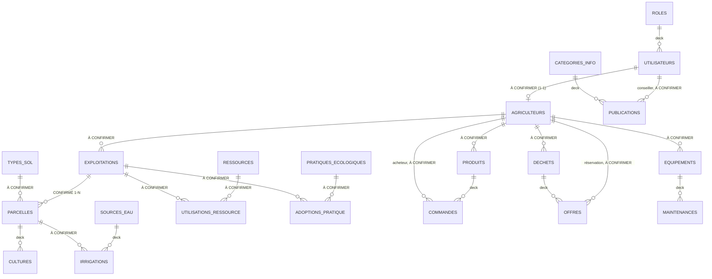

# ECOAGRI: class diagram and database mapping

Sources: the "Présentation ECOAGRI" deck v2 (per-module slides, use cases) and the entity list of your master prompt.
Deck v2 no longer contains the MCD summary slide.
**Only Exploitation–Parcelle is confirmed in the MCD.** Every other link is either read from a
per-module slide of the deck (marked *deck*) or an assumption (marked *À CONFIRMER*).

## Points to confirm with the tutor

1. **Roles**: three (agriculteur, conseiller, administrateur). See `docs/use-cases.md` for the stale "Acheteur" texts.
2. **Two models**: the master prompt's entities (Exploitation, Ressource, PratiqueÉcologique…) and the module slides
   (Produit, Commande, Déchet, Offre, Publication, Équipement…) were never merged in the deck. This schema merges them.
3. **Équipement / Maintenance** are in the deck but outside the six modules.
4. **Text columns replaced by foreign keys**: `nom_agriculteur`, `nom_acheteur`, `nom_parcelle`, `type_sol`.
5. **Permissions**: no permissions table in the deck.
6. **Attributes** of Agriculteur, Exploitation, Ressource, UtilisationRessource and PratiqueÉcologique are not defined.
